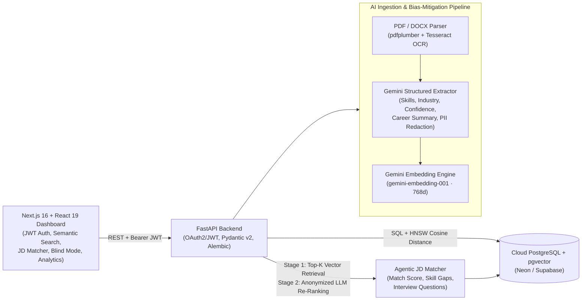

# Strata — Talent Intelligence & Agentic Hiring Engine

[](.github/workflows/ci.yml)
[](backend/main.py)
[](frontend/package.json)
[](backend/alembic/versions/0001_initial_schema.py)
[](backend/services/llm_service.py)

**Strata** is an enterprise-grade B2B Talent Intelligence & Agentic Hiring platform that transforms unstructured PDF/DOCX resumes into structured, bias-mitigated, vector-indexed talent layers. Recruiters can search candidates in natural language via **`pgvector` cosine similarity**, enforce **server-side Blind Screening (PII redaction)**, plug in their own API key via **Zero-Storage BYOK**, and run a **two-stage RAG Agentic Job Description Matcher** with skill-gap analysis and tailored interview questions.

---

## System Architecture



---

## Key Capabilities

- **Two-Stage Agentic JD Matching (`POST /api/match`):** Embeds a Job Description, retrieves top-$K$ candidates via `pgvector` HNSW cosine similarity, then sends **strictly anonymized** candidate profiles to Gemini (`gemini-4-hydrogen` with automatic model failover) to generate `0–100` match scores, matched/missing skills, evidence-based justifications, and tailored interview questions.
- **Semantic Vector Search (`GET /api/candidates/search`):** Natural-language talent discovery powered by `768`-dimension `gemini-embedding-001` vectors and a PostgreSQL `pgvector` HNSW cosine index (`ix_candidates_embedding_hnsw`), combinable with structured pre-filters (`industry`, `experience`, `work_mode`).
- **Automated Bias Mitigation (Blind Screening):** Automatically generates PII-redacted resumes during ingestion (`[REDACTED_NAME]`, `[REDACTED_EMAIL]`, `[REDACTED_PHONE]`, `[REDACTED_LOCATION]`, `[REDACTED_INSTITUTION]`) and enforces server-side masking across search, matching, and profile endpoints when `blind_mode=true`.
- **Structured LLM Extraction & Multi-Model Resilience:** Extracts normalized skills, industry classification with confidence score, career trajectory, education, and summary via strict Pydantic JSON schemas—backed by automatic retry, multi-model failover (`gemini-4-hydrogen` -> `gemini-3.8-flash` -> `gemini-3.5-flash-lite`), and deterministic fallbacks.
- **Zero-Storage Hybrid BYOK (Bring Your Own Key):** Works out of the box with Strata's managed `GEMINI_API_KEY`, or lets users plug in their own Google AI Studio key in **AI Key (BYOK)** settings—kept strictly in ephemeral browser `sessionStorage` and transmitted per-request via `X-Gemini-API-Key` without ever writing user keys to the database, disk, or logs.
- **Production Auth & Schema Migrations:** Full JWT authentication (`PyJWT` + `bcrypt`) with role support (`recruiter`, `hiring_manager`), protected API routes, and versioned **Alembic** migrations with serverless PostgreSQL connection pooling (`pool_pre_ping` + TCP keepalives).

---

## Tech Stack

| Layer | Technologies |
| :--- | :--- |
| **Frontend** | Next.js 16, React 19, TypeScript, Recharts, Lucide Icons |
| **Backend** | FastAPI, SQLAlchemy 2.0, Pydantic v2, Alembic, PyJWT, bcrypt |
| **Database** | Cloud PostgreSQL (Neon / Supabase) + `pgvector` (HNSW cosine index) |
| **AI / NLP** | Google GenAI SDK (`gemini-4-hydrogen`, `gemini-embedding-001`), `pdfplumber`, `python-docx`, Tesseract OCR |
| **DevOps & QA** | Docker & Docker Compose, GitHub Actions CI, Pytest, TypeScript strict check |

---

## API Reference

| Method & Path | Auth | Description |
| :--- | :---: | :--- |
| `GET /api/health` | Public | Verifies database connectivity and `pgvector` extension status |
| `POST /api/auth/register` | Public | Registers a recruiter / hiring manager and returns a Bearer JWT |
| `POST /api/auth/login` | Public | Authenticates credentials (`bcrypt`) and returns a Bearer JWT |
| `GET /api/auth/me` | JWT | Returns the authenticated user profile |
| `POST /api/upload` | JWT | Ingests PDF/DOCX resumes -> Gemini extraction -> PII redaction -> `pgvector` |
| `GET /api/candidates` | JWT | Paginated candidate listing (`skip`, `limit`, `X-Total-Count`, `blind_mode`) |
| `GET /api/candidates/search` | JWT | Natural-language `pgvector` semantic search + structured pre-filters |
| `POST /api/candidates/reindex` | JWT | Backfills missing embeddings and PII redaction in batches |
| `POST /api/match` | JWT | Two-stage RAG Agentic JD-to-Candidate matching & interview questions |
| `GET /api/settings/ai-status` | JWT | Reports active AI mode (`byok` vs `server_default`) & available Gemini models |
| `POST /api/settings/test-ai-key` | JWT | Live-verifies a Zero-Storage BYOK `X-Gemini-API-Key` or managed key |
| `GET / DELETE /api/candidates/{id}` | JWT | Retrieve (with optional `blind_mode`) or delete a candidate profile |

---

## Quickstart

### 1. Configure Environment Variables
Copy the example env files and add your **Neon / Supabase** PostgreSQL URL and **Google AI Studio** Gemini API key:

```bash
cp backend/.env.example backend/.env
cp frontend/.env.example frontend/.env.local
```

Generate a strong `JWT_SECRET_KEY`:
```bash
openssl rand -hex 32
```

### 2. Run Locally (Development)

**Backend (FastAPI + Alembic):**
```bash
cd backend
python3 -m venv .venv
source .venv/bin/activate
pip install -r requirements.txt
alembic upgrade head
uvicorn main:app --reload
```
API docs available at `http://localhost:8000/docs`.

**Frontend (Next.js):**
```bash
cd frontend
npm ci
npm run dev
```
Dashboard available at `http://localhost:3000`.

### 3. Run with Docker Compose (One-Command Launch)
With `backend/.env` configured, start both production containers:
```bash
docker compose up --build
```

---

## Running Tests & Verification

```bash
# Backend unit & integration tests (11 tests covering JWT, Gemini mocking, pgvector search & JD matching)
backend/.venv/bin/pytest backend/tests -v

# Frontend TypeScript check, lint & production build
cd frontend
npx tsc --noEmit
npm run lint
npm run build
```
